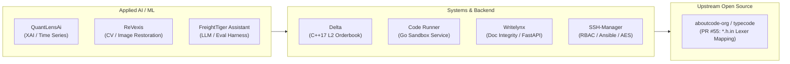

<div align="center">



# Nikhil Anand

**Software Engineer &nbsp;|&nbsp; Applied AI/ML &nbsp;|&nbsp; Systems &amp; Open Source**

[GitHub](https://github.com/nikhilanand0105) &nbsp;·&nbsp;
[Repositories](https://github.com/nikhilanand0105?tab=repositories) &nbsp;·&nbsp;
[Open-Source PRs](https://github.com/search?q=author%3Anikhilanand0105+type%3Apr) &nbsp;·&nbsp;
[LinkedIn](https://linkedin.com/in/nikhil-anand0105) &nbsp;·&nbsp;
[Email](mailto:nikhilanand0105@gmail.com)

</div>

---

### Executive Overview

I am a software engineer focused on building robust applied AI/ML systems, distributed backends, and reliable developer tooling across **Python, C++, Go, Java, Kotlin, TypeScript, and JavaScript**. My work centers on turning complex technical challenges into verifiable, well-tested software—ranging from closed-loop explainable AI (XAI) pipelines and high-speed C++ orderbook matching engines to Go sandbox execution runtimes and OOXML document parsing systems.

In open source, I value disciplined upstream collaboration: reproducing edge cases, constructing deterministic regression test fixtures, and submitting focused changes to established codebases such as [TypeCode](https://github.com/aboutcode-org/typecode).

---

### Core Technical Focus

- **Applied AI &amp; Machine Learning** — Explainable AI (Grad-CAM, TreeSHAP, perturbation sensitivity), computer vision for defect inspection, and verifiable LLM evaluation harnesses.
- **Systems &amp; High-Performance Computing** — Sub-microsecond Level-2 limit orderbook processing (C++17), cryptographic signature pipelines (RFC HMAC-SHA256), and concurrent code execution microservices (Go).
- **Backend &amp; Distributed Systems** — High-concurrency RESTful and asynchronous services, task queue architectures (Celery/RabbitMQ/Redis), and ACID-compliant relational schemas.
- **Systems Security &amp; Infrastructure** — Envelope encryption (AES-CBC KEK/DEK), SSH CA trust models (`TrustedUserCAKeys`), role-based access control (RBAC), and automated cloud provisioning.
- **Developer Tooling &amp; Reliability** — Deterministic test suites (pytest/Playwright/CTest/Go test), CI/CD workflows (GitHub Actions), AST/lexing grammar extensions, and strict data retention lifecycles.



---

### Selected Engineering Projects

```
┌────────────────────────────────────────────────────────────────────────────────────────┐
│ SELECTED PROJECTS MATRIX                                                               │
├──────────────────────────┬─────────────────────────────────────┬───────────────────────┤
│ System                   │ Focus                               │ Verification          │
├──────────────────────────┼─────────────────────────────────────┼───────────────────────┤
│ QuantLensAi              │ Closed-Loop Explainable AI Platform │ 30 Invariants + CI    │
│ Delta                    │ High-Performance C++17 L2 Orderbook │ CTest + NIST Vectors  │
│ Code-Runner-as-a-Service │ Concurrent Go Execution Sandbox     │ Context Timeouts + CI │
│ Writelynx                │ Document Integrity & Revision Engine│ 20-Step E2E + Pytest  │
│ SSH-Manager              │ Fleet Access & Key Provisioning     │ Model & ACL Test Suite│
│ ReVexis                  │ Semiconductor Defect Restoration    │ Empirical Edge Metric │
│ FreightTiger AI Assistant│ Local LLM Evaluation Harness        │ Mutation Testing + QA │
│ JARVIS Device Agent      │ On-Device Android Task Orchestrator │ View Hierarchy Tests  │
└──────────────────────────┴─────────────────────────────────────┴───────────────────────┘
```

#### 1. [QuantLensAi](https://github.com/nikhilanand0105/QuantLensAi) — Closed-Loop Explainable AI Platform
*Academic Research Prototype &amp; Automated AWS Cloud Deployment*

- **The Problem:** Financial machine learning models frequently operate as black boxes, making it difficult to detect when a model relies on spurious correlations before severe drawdown occurs in volatile market regimes.
- **Architecture &amp; Decisions:**
  - Implemented a closed-loop XAI architecture integrating **1D Grad-CAM** (temporal convolution attribution) and **TreeSHAP** to compute feature-level saliency for time-series predictions.
  - Built a 10-metric evaluation suite (Sharpe ratio, Calmar ratio, maximum drawdown, attribution stability, and perturbation sensitivity) comparing 1D-CNN, MLP, and XGBoost models.
  - Implemented a paper-trading simulation engine validated against a **30-invariant test suite** enforcing capital conservation, trade atomicity, and leverage guardrails.
  - Automated cloud provisioning using AWS CloudFormation, EC2 systemd daemon management, and Nginx reverse proxy.
- **Tech Stack:** Python 3.11, PyTorch (1D-CNN, MLP), XGBoost, SHAP, NumPy, Pandas, MongoDB, Docker, AWS (EC2/CloudFormation).

#### 2. [Delta](https://github.com/nikhilanand0105/Delta) — High-Performance C++17 Trading &amp; Orderbook Engine
*Systems &amp; High-Frequency Trading Core Library*

- **The Problem:** Market making and algorithmic arbitrage require sub-microsecond limit orderbook processing and deterministic message authentication without heap allocations on hot paths.
- **Architecture &amp; Decisions:**
  - Built a high-performance **Level-2 Limit Orderbook (LOB)** with descending bid and ascending ask red-black tree indices, supporting $O(1)$ top-of-book retrieval and dynamic spread tracking.
  - Developed a zero-external-dependency **RFC-compliant SHA-256 and HMAC-SHA256 signature engine** for Delta Exchange REST and WebSocket authentication.
  - Enforced strict invariants through unit tests covering order insertion, level updates, order cancellation (`size == 0`), and NIST test vectors.
- **Tech Stack:** C++17, Clang++, Make, CMake, CTest, Standard Library Algorithms.

#### 3. [Code-Runner-as-a-Service](https://github.com/nikhilanand0105/Code-Runner-as-a-Service) — Concurrent Code Execution Sandbox
*Cloud-Native Go Microservice*

- **The Problem:** Running untrusted user code in web platforms requires strict memory limits, execution deadlines, and process sandboxing to prevent resource exhaustion and hanging workers.
- **Architecture &amp; Decisions:**
  - Implemented a concurrent execution engine in **Go 1.22** supporting Python, JavaScript, C++, Bash, and Go runtimes.
  - Sandboxed execution via ephemeral isolated directories and `context.WithTimeout` deadline propagation.
  - Output stream capture with a 1 MB hard buffer cap to prevent runaway log allocation.
  - Packaged in a multi-stage Docker container with multi-runtime base image and GitHub Actions CI.
- **Tech Stack:** Go 1.22, Docker, Linux cgroups/subprocesses, HTTP REST API, GitHub Actions CI.

#### 4. [Writelynx](https://github.com/nikhilanand0105/writelynx) — Academic Document Integrity &amp; Revision Platform
*Production-Grade Distributed Web Application*

- **The Problem:** Automated manuscript revision tools frequently damage complex OpenXML formatting (tables, cross-references, equations) or upload unencrypted drafts to third-party APIs without data retention guarantees.
- **Architecture &amp; Decisions:**
  - Built a structure-preserving **DOCX/OOXML Abstract Syntax Tree (AST) engine** that isolates text runs for revision while guaranteeing zero formatting drift or schema corruption.
  - Architected an asynchronous multi-tier pipeline using **FastAPI**, **Celery**, and **Redis** behind a **Caddy** edge proxy for automated TLS termination and static serving.
  - Enforced security governance with automated 7-day document expiration routines, pre-signed upload validators, and rate-limited API endpoints.
  - Verified through a 20-step end-to-end integration test suite, Alembic schema migrations, and Playwright UI tests.
- **Tech Stack:** FastAPI, Python, React 18, TypeScript, Celery, Redis, PostgreSQL, Alembic, Caddy, Tailwind CSS, Docker.

#### 5. [SSH-Manager](https://github.com/nikhilanand0105/SSH-Manager) — Centralized Access Governance &amp; Key Provisioning
*Distributed Systems &amp; Infrastructure Security Platform*

- **The Problem:** Dispersed SSH keys across heterogeneous server fleets lead to credential sprawl, stale authorized keys, and lack of verifiable audit trails during access revocation.
- **Architecture &amp; Decisions:**
  - Designed an **Envelope Encryption architecture** (AES-CBC with KEK/DEK hierarchy) to secure stored private keys and credentials in PostgreSQL via SQLAlchemy.
  - Implemented role-based access control (RBAC) supporting temporary credential issuance and automated access revocation.
  - Orchestrated fleet-wide key provisioning asynchronously via **Celery task workers** driving **Ansible playbooks** across host nodes configured with `TrustedUserCAKeys`.
  - Comprehensive automated test coverage including unit tests for ACL models, session lifecycles, and controller integration.
- **Tech Stack:** Python, Flask, Celery, RabbitMQ, PostgreSQL, SQLAlchemy, Ansible, Cryptography (AES-CBC), Pytest.

#### 6. [ReVexis](https://github.com/nikhilanand0105/ReVexis) — Semiconductor Defect-Inspection Restoration Pipeline
*Scientific Computer Vision &amp; Deep Learning System (KLA i4C Hackathon Finalist)*

- **The Problem:** Standard denoising filters blur sub-micron structural edges in high-noise scanning electron microscopy (SEM) and optical wafer inspection, creating false negatives in automated defect detection.
- **Architecture &amp; Decisions:**
  - Designed a custom PyTorch image-restoration neural network with inspection-aware loss penalties prioritizing high-frequency edge gradients over uniform smoothing.
  - Built a synthetic degradation generator modeling semiconductor noise distributions (Poisson shot noise, Gaussian sensor noise, optical blur).
  - Integrated a Next.js inspection dashboard with a FastAPI inference backend for real-time before/after defect review.
- **Tech Stack:** PyTorch, Python, OpenCV, NumPy, FastAPI, Next.js, TypeScript, Tailwind CSS.

#### 7. [FreightTiger AI Assistant (`caseStudy`)](https://github.com/nikhilanand0105/caseStudy) — Offline LLM Logistics Reasoning &amp; Eval Harness
*Applied LLM Engineering &amp; Verification Suite*

- **The Problem:** Unchecked generative language models hallucinate shipment states and create compliance liabilities when answering operational logistics queries.
- **Architecture &amp; Decisions:**
  - Integrated a local, offline-first LLM workflow via **Ollama**, eliminating third-party API exposure and external latency bottlenecks.
  - Built a strict evidence-policy validation engine requiring verified citations against ground-truth shipment manifests before emitting outputs.
  - Engineered an automated evaluation harness with mutation testing, repeated-run reproducibility tracking, and token cost telemetry.
- **Tech Stack:** Python, Ollama, Pydantic, Pandas, Pytest, JSON Schema, Regex.

#### 8. [JARVIS Mobile Agent (`jarvis-baba`)](https://github.com/nikhilanand0105/jarvis-baba) — On-Device Android Autonomous Agent
*Mobile Systems Engineering &amp; Autonomous Interaction Framework*

- **The Problem:** Automating complex, multi-step actions on mobile platforms typically requires brittle UI coordinate hacks that break with minor layout or resolution changes.
- **Architecture &amp; Decisions:**
  - Implemented an on-device perception framework leveraging the native **Android AccessibilityService API** to traverse live UI node trees and semantic view hierarchies dynamically.
  - Architected modular application plugins (Instagram, Uber, Blinkit, Chrome, Gmail) with perception-action feedback loops and verification checks.
  - Enforced security and policy guardrails to prevent unintended interactions or privilege escalation.
- **Tech Stack:** Kotlin, Android SDK, Jetpack Compose, AccessibilityService APIs, Coroutines, Gradle.

---

### Open-Source Contributions

I treat open-source contributions as an exercise in engineering discipline: understanding established project norms, setting up reproducible local environments, and submitting clean, well-tested diffs.

| Repository | Contribution | PR Status | Technical Details |
|---|---|---|---|
| **[aboutcode-org/typecode](https://github.com/aboutcode-org/typecode)** | [PR #55: Recognize `*.h.in` template files as C source](https://github.com/aboutcode-org/typecode/pull/55) | **Open / Under Review** | • Added `*.h.in` filename pattern mapping to `CLexer` in `src/typecode/pygments_lexers_mapping.py`<br>• Added real-world `config.h.in` regression fixture<br>• Added YAML test expectations verifying detected file properties<br>• Verified with 18 existing C/C++ tests passing and Ruff clean |
| **[aboutcode-org/scancode-toolkit](https://github.com/aboutcode-org/scancode-toolkit)** | [scancode-toolkit fork](https://github.com/nikhilanand0105/scancode-toolkit) | Tracking `develop` | • Tracking upstream development for package detection and license identification workflows |

---

### Technical Skills

| Domain | Technologies &amp; Tooling |
|---|---|
| **Languages** | Python, C++, Go, Java, Kotlin, TypeScript, JavaScript, SQL, Bash |
| **Applied AI &amp; ML** | PyTorch, XGBoost, Scikit-learn, OpenCV, 1D Grad-CAM, SHAP, Ollama, Hugging Face |
| **Systems &amp; High-Performance** | C++17, Go (Golang), Multithreading, In-Memory Orderbooks, HMAC Signatures, Subprocess Sandboxing |
| **Backend &amp; Distributed** | FastAPI, Flask, Celery, RabbitMQ, Redis, PostgreSQL, MongoDB, SQLAlchemy, Alembic |
| **Infrastructure &amp; DevOps**| Docker, Docker Compose, AWS (EC2, CloudFormation, CloudWatch), Caddy, Nginx, Linux (systemd), Git, GitHub Actions |
| **Frontend &amp; Mobile** | React 18, Next.js, TypeScript, JavaScript (ES2024), Tailwind CSS, Android SDK, Jetpack Compose |
| **Testing &amp; Quality** | Pytest, Playwright, CTest, Go testing, Ruff, Flake8, Pre-commit hooks |

---

### Security &amp; Documentation Integrity Principles

All project showcases and code repositories adhere to verified security and privacy standards:
- **No hardcoded secrets:** All credentials, tokens, and keys are managed via environment variables and `.env.example` templates.
- **Authentic metrics:** Benchmark results, invariant test counts, and empirical evaluations reflect reproducible source code runs without exaggerated claims.
- **Privacy protection:** Academic registration numbers, personal phone numbers, and non-public contact data are protected across public documentation.

---

<div align="center">

<sub>Built with technical rigor, verified implementations, and open-source discipline.</sub>

</div>
